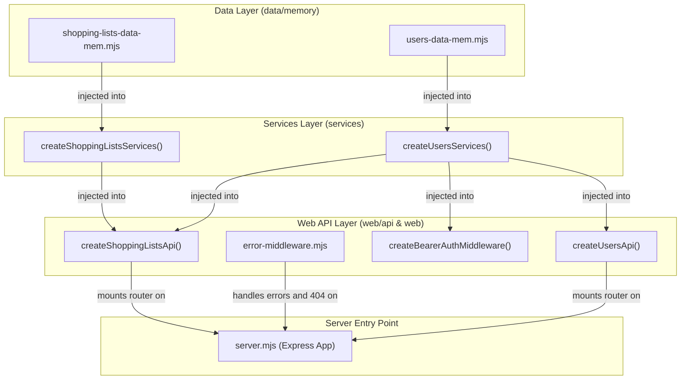
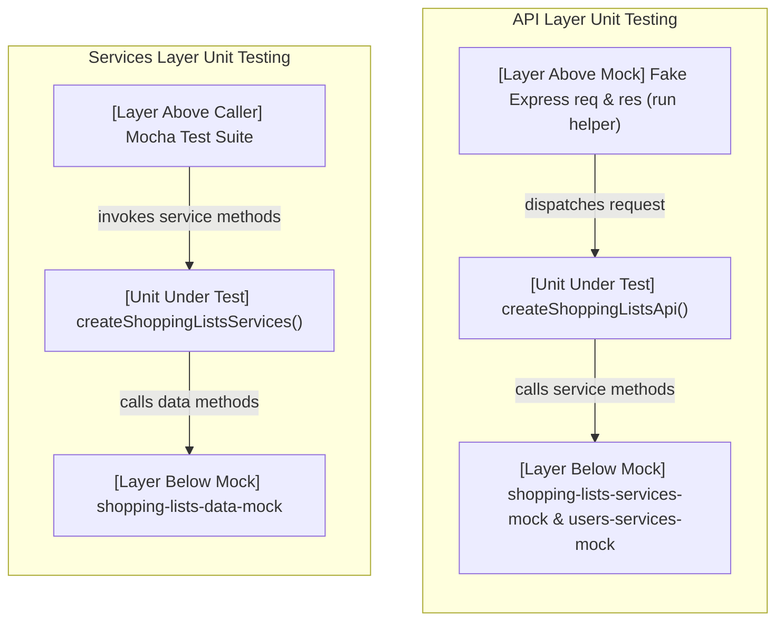

# Shopping Lists App

A web application for creating and managing shopping lists, developed for the APW (Web Programming and Architecture) course at ISEL (LEIC 33D/34D, 2026/27).

## Features

- Create a user.
- Authenticate requests with an API token (Bearer).
- Get all shopping lists.
- Get, create, edit and remove a shopping list.
- Add, update partially and remove items from a list.
- Requests and responses must be in JSON format.
- Each user only accesses their own shopping lists.

## Application Resources

- `/api/users`
    - POST (create a user, no authentication required)
- `/api/lists`
    - GET (get all shopping lists)
    - POST (create a shopping list)
- `/api/lists/:id`
    - GET (get a specific shopping list)
    - PUT (edit a shopping list)
    - DELETE (remove a shopping list)
- `/api/lists/:id/items`
    - POST (create an item in a shopping list)
- `/api/lists/:id/items/:itemId`
    - DELETE (remove an item from a shopping list)
    - PATCH (partial update of an item in a shopping list)

## Authentication

All resources, except `POST /api/users`, require the header `Authorization: Bearer <apiToken>`. The `apiToken` is returned when a user is created.

## Architecture & Dependency Injection

The application is structured into three main layers following separation of concerns, with dependencies explicitly passed through factory functions (Dependency Injection):

- **Data Layer**: Exports data access functions for in-memory storage.
- **Services Layer**: Encapsulates business logic, parameter validation, and error checking. Receives the data module as a dependency.
- **Web API Layer**: Handles HTTP requests, response formatting, status codes, authentication, and centralized error handling (JSON parser errors, 404 routes, and unhandled errors). Receives the services modules as dependencies.
- **Server Entry Point (`server.mjs`)**: Composition root where all dependencies are instantiated and wired into Express route handlers and error middleware.



## Testing & Mocking Strategy

Unit tests isolate each layer by mocking the layer directly below it (to simulate dependencies) and simulating the layer above it (to trigger actions):

- **API Layer Tests (`shopping-lists-api-test.mjs`)**:
  - **Layer Above (Mocked)**: Express `req` and `res` objects dispatched to the Router via a `run()` helper function.
  - **Unit Under Test**: `createShoppingListsApi()` (Express Router).
  - **Layer Below (Mocked)**: `shopping-lists-services-mock.mjs` and `users-services-mock.mjs` simulate business logic and token verification.
- **Services Layer Tests (`shopping-lists-services-test.mjs`)**:
  - **Layer Above (Caller)**: Mocha test suite invoking service methods directly.
  - **Unit Under Test**: `createShoppingListsServices()`.
  - **Layer Below (Mocked)**: `shopping-lists-data-mock.mjs` simulates data persistence and error scenarios.



## API Documentation

The OpenAPI specification is in `docs/openapi.yaml`. Swagger UI is available at `http://localhost:8000/api-docs`.

## Getting Started

### Prerequisites

- [Node.js](https://nodejs.org/) (LTS version)
- npm

### Installation

```bash
git clone <repository-url>
cd 2627-leic33D-34D-shopping-lists-app
npm install
```

### Running the Application

```bash
npm run start
```

The application will be available at `http://localhost:8000`.

### Running Tests

```bash
npm test
```

## License

This project is for academic purposes.
